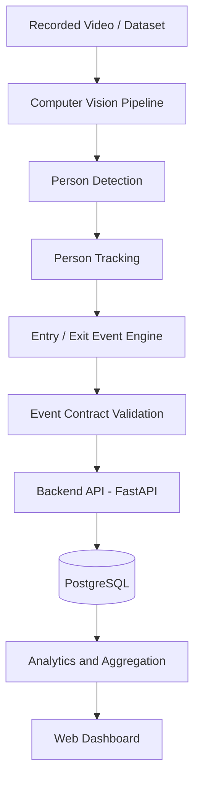

# Footfall Cam

**AI-Powered People Counting and Retail Analytics Platform**

Footfall Cam is a software platform designed to analyze visitor traffic and customer movement in physical retail environments using computer vision, data analytics, and modern backend technologies.

The project aims to build a scalable foundation for measuring footfall, understanding customer movement patterns, monitoring queue activity, and transforming camera footage into actionable retail insights.

> **Project Status:** Proof of Concept (PoC) — under development.

---

## Table of Contents

- [Project Overview](#project-overview)
- [Objectives](#objectives)
- [Planned Features](#planned-features)
- [System Architecture](#system-architecture)
- [Technology Stack](#technology-stack)
- [Repository Structure](#repository-structure)
- [Getting Started](#getting-started)
- [Development Workflow](#development-workflow)
- [Event Contract](#event-contract)
- [Testing and Code Quality](#testing-and-code-quality)
- [Team Responsibilities](#team-responsibilities)
- [Privacy and Security](#privacy-and-security)
- [Roadmap](#roadmap)
- [Contributing](#contributing)
- [License](#license)

---

## Project Overview

Retail businesses need reliable insights into how visitors enter, move through, and interact with physical spaces.

Footfall Cam aims to provide these insights through a computer vision pipeline that processes video footage, identifies and tracks people, generates movement events, and makes analytical results available through a backend API and dashboard.

The initial implementation focuses on a software-based proof of concept using recorded video and suitable datasets. Live camera integration and production deployment are future milestones.

## Objectives

- Develop a computer vision pipeline for person detection and tracking.
- Estimate visitor entry and exit counts using virtual counting lines.
- Establish a standardized event contract between system components.
- Build a backend API for collecting and querying analytics events.
- Store events and aggregated metrics for reporting.
- Develop a dashboard for visualizing retail traffic metrics.
- Establish automated testing, code quality checks, and CI workflows.
- Design a foundation that can evolve toward production deployment.

## Planned Features

| Feature | Description |
|---|---|
| People Counting | Estimate visitor entries and exits from video footage. |
| Person Tracking | Track detected people across video frames. |
| Footfall Analytics | Calculate visitor counts over configurable time intervals. |
| Dwell Time | Explore estimates of how long visitors remain in defined areas. |
| Queue Analytics | Explore queue length and waiting-time estimation. |
| Zone Analytics | Analyze activity within defined store sections. |
| Analytics Dashboard | Present aggregated metrics and visual reports. |
| API Integration | Expose analytics data through backend endpoints. |

*These are project goals, not a claim that every feature is already implemented or validated.*

---

## System Architecture

The planned architecture separates video processing, analytics ingestion, data storage, and visualization.



### Component Responsibilities

**1. Computer Vision**

Processes video frames, detects people, tracks detections across frames, and identifies potential entry and exit events.

**2. Event Contract**

Defines a shared, versioned data format so the computer vision and backend components can communicate consistently.

**3. Backend API**

Receives validated events, handles application logic, and provides endpoints for retrieving analytics.

**4. Database**

Stores events and relevant aggregated metrics for querying and reporting.

**5. Frontend Dashboard**

Visualizes footfall metrics and analytics for business users.

**6. CI Pipeline**

Runs automated code quality checks, contract validation, and tests to identify problems before changes are merged.

---

## Technology Stack

The following technologies are planned or being evaluated for the PoC.

| Area | Technology |
|---|---|
| Programming Language | Python |
| Computer Vision | OpenCV and a suitable person-detection model |
| Backend API | FastAPI |
| Data Validation | JSON Schema and Pydantic where appropriate |
| Database | PostgreSQL |
| Dependency Management | uv |
| Linting and Formatting | Ruff |
| Testing | pytest |
| Version Control | Git and GitHub |
| Continuous Integration | GitHub Actions |
| Containerization | Docker and Docker Compose, when needed |
| Frontend | React and a suitable charting library |

Technology choices may evolve as the project requirements become clearer.

---

## Repository Structure

The repository is organized by component to support parallel development.

```text
footfall-cam/
├── .github/
│   ├── ISSUE_TEMPLATE/
│   ├── workflows/
│   │   └── ci.yml
│   └── PULL_REQUEST_TEMPLATE.md
├── backend/
│   ├── src/
│   │   └── footfall/
│   ├── tests/
│   └── pyproject.toml
├── computer-vision/
│   ├── src/
│   │   └── footfall_cv/
│   └── tests/
├── frontend/
├── contracts/
│   └── events/
│       ├── event.schema.json
│       └── examples/
├── scripts/
│   └── validate_events.py
├── docs/
├── .gitignore
├── CONTRIBUTING.md
├── pyproject.toml
└── README.md
```

The structure represents the intended organization. Directories and files should be added as their components are implemented.

---

## Getting Started

### Prerequisites

Install the following tools before starting development:

- Git
- Python version compatible with the project configuration
- uv
- A code editor such as VS Code or Cursor

### 1. Clone the Repository

```bash
git clone <REPOSITORY_URL>
cd footfall-cam
```

Replace `<REPOSITORY_URL>` with the actual repository URL.

### 2. Install uv

Follow the official installation instructions:

https://docs.astral.sh/uv/getting-started/installation/

Verify the installation:

```bash
uv --version
```

### 3. Set Up the Environment

If the repository already contains `pyproject.toml` and `uv.lock`, run:

```bash
uv sync --locked
```

This creates or synchronizes the local project environment using the committed dependency definitions.

If the lockfile does not exist yet, initialize and resolve project dependencies before using `--locked`.

### 4. Run Code Quality Checks

```bash
uv run ruff check .
uv run ruff format --check .
```

These commands check linting rules and formatting without automatically modifying files.

### 5. Run Tests

```bash
uv run pytest
```

Tests should be added as the backend and computer vision components are developed.

### 6. Validate Event Examples

If the event schema and validation script are available, run:

```bash
uv run python scripts/validate_events.py
```

This validates the example event files against the shared JSON Schema.

---

## Development Workflow

Footfall Cam follows a GitHub-based collaboration workflow.

1. Create a feature branch from the latest `main`.
2. Implement a focused change.
3. Run relevant linting, formatting, and tests.
4. Commit your changes using a descriptive message.
5. Push the branch to GitHub.
6. Open a Pull Request targeting `main`.
7. Review the changes and ensure required CI checks pass.
8. Merge after approval and successful checks.

### Branch Naming

Examples:

```text
feature/person-tracking
feature/entry-exit-detection
feature/analytics-api
feature/dashboard
fix/event-validation
chore/ci-setup
```

### Commit Message Examples

```text
feat: add entry and exit event processing
fix: handle invalid event timestamps
test: add event schema validation tests
ci: configure automated quality checks
docs: update system architecture
```

See [CONTRIBUTING.md](CONTRIBUTING.md) for the detailed contribution guidelines.

---

## Event Contract

The event contract defines the interface between computer vision and backend components.

A preliminary entry event may look like this:

```json
{
  "schema_version": "1.0",
  "event_id": "evt_001",
  "store_id": "store_001",
  "camera_id": "cam_001",
  "event_type": "entry",
  "timestamp": "2026-10-16T10:30:00Z",
  "track_id": 17,
  "source": "computer_vision"
}
```

### Contract Principles

- `schema_version` identifies the event format version.
- `event_id` uniquely identifies an event and supports duplicate detection.
- `store_id` and `camera_id` identify the event's source.
- `event_type` identifies the event category, such as `entry` or `exit`.
- `timestamp` uses UTC in ISO 8601 format.
- `track_id` identifies a tracking instance within the computer vision pipeline; it must not be treated as a persistent person's identity.
- `source` identifies the producing component.

The schema validates the structure and allowed values of an event. It does not prove that the underlying detection or entry/exit classification is correct.

Contract changes should be reviewed carefully to preserve compatibility between components.

---

## Testing and Code Quality

Automated quality checks are intended to run through GitHub Actions on relevant pushes and pull requests.

The initial CI workflow may include:

- Python linting with Ruff.
- Python formatting checks with Ruff.
- Event schema validation.
- Automated tests with pytest.
- Dependency consistency checks using uv.

As the system grows, additional tests should cover API behavior, database operations, event deduplication, computer vision logic, and integration between components.

CI success indicates that configured checks passed; it does not by itself guarantee model accuracy or production readiness.

---

## Team Responsibilities

The project is developed collaboratively across four areas.

| Role | Responsibilities |
|---|---|
| Computer Vision | Detection, tracking, counting logic, video processing, and evaluation. |
| MLOps | Development environment, dependency management, CI/CD, packaging, deployment, monitoring, and reproducibility. |
| Backend | API design, event ingestion, validation, persistence, and analytics endpoints. |
| Frontend | Dashboard UI, API integration, charts, and analytics presentation. |

All components should follow the shared event contract and agree on API interfaces before integrating major changes.

---

## Privacy and Security

Privacy and security are design requirements, not optional deployment enhancements.

- Use authorized video footage and datasets.
- Avoid collecting personally identifiable information unless explicitly required and appropriately authorized.
- Prefer anonymous tracking identifiers over persistent person identification.
- Do not commit credentials, API keys, database passwords, or production secrets.
- Keep local environment files out of version control.
- Validate incoming API requests and restrict access to sensitive endpoints.
- Define data retention and access-control policies before production deployment.
- Evaluate applicable privacy and surveillance regulations before using the system in real retail environments.

---

## Roadmap

### Phase 1 — Project Foundation
- [x] Establish initial repository conventions.
- [x] Define a preliminary event contract.
- [x] Prepare an initial CI workflow.
- [ ] Add automated contract tests.
- [ ] Finalize contribution and branch protection rules.

### Phase 2 — Computer Vision PoC
- [ ] Select and evaluate a suitable person-detection model.
- [ ] Process recorded video.
- [ ] Implement person tracking.
- [ ] Implement virtual-line entry and exit detection.
- [ ] Evaluate counting accuracy on representative footage.

### Phase 3 — Backend and Storage
- [ ] Implement FastAPI endpoints.
- [ ] Add runtime event validation.
- [ ] Integrate PostgreSQL.
- [ ] Implement duplicate-event handling.
- [ ] Add automated unit and integration tests.

### Phase 4 — Analytics Dashboard
- [ ] Connect the frontend to the backend API.
- [ ] Display entry and exit counts.
- [ ] Add time-based analytics.
- [ ] Introduce additional metrics as they are implemented and validated.

### Phase 5 — Integration and Deployment
- [ ] Integrate the CV pipeline, backend, database, and frontend.
- [ ] Add Docker Compose where useful.
- [ ] Extend CI with integration and container checks.
- [ ] Prepare a reproducible demonstration environment.
- [ ] Evaluate production requirements for deployment, monitoring, reliability, and security.

---

## Contributing

Contributions are welcome from all project team members.

Before submitting a Pull Request:

- Keep changes focused and clearly scoped.
- Follow the established repository structure.
- Update the event contract when required.
- Add tests for new behavior.
- Run the relevant quality checks locally.
- Document new configuration requirements.
- Never commit secrets or unauthorized video data.

See [CONTRIBUTING.md](CONTRIBUTING.md) for complete instructions.

---

## License

The project license has not yet been specified. Usage, modification, and distribution terms should be defined before the repository is publicly released.
